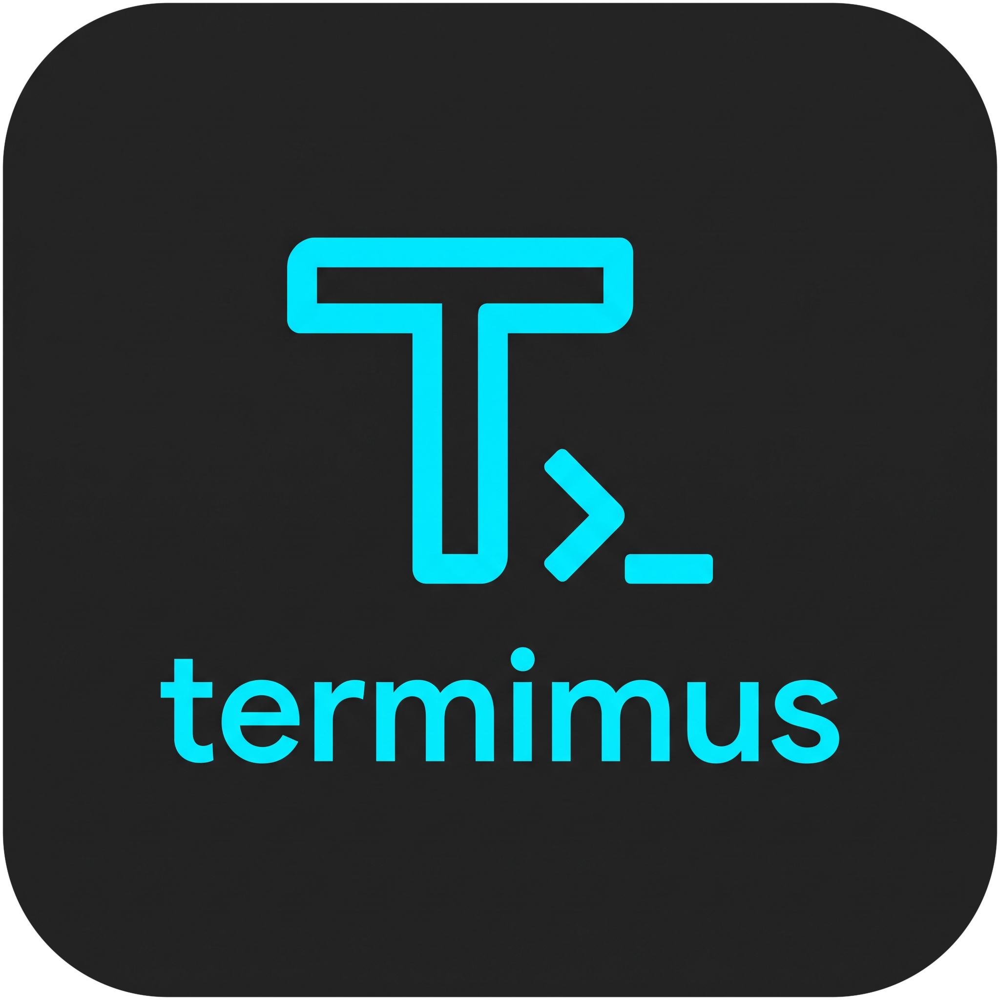

<p align="center">
  
</p>

<h1 align="center">Termimus</h1>

<p align="center">A lightweight, open-source SSH client for managing many servers.<br>
Windows · macOS · Linux</p>

Termimus keeps your servers in one place, organised by group, and opens each
one in its own terminal or file-browser tab with a single click. It is a small
native app built with Go and [Wails](https://wails.io) that uses the operating
system's own web view (WebView2, WKWebView, WebKitGTK) instead of bundling a browser.

## Features

- **Host manager**: add, edit, and delete hosts; organise them into groups; search by name, address, or user.
- **Keychain**: generate ED25519 / RSA 4096 / ECDSA keys or import existing ones (including passphrase-protected keys), and copy the public key in one click. Keys are stored encrypted inside Termimus, so hosts don't depend on a key file path.
- **SFTP file browser**: browse, upload, download (files and whole folders), rename, delete, create folders, and drag files in from your file manager, with progress reporting.
- **Export / import**: move all hosts, passwords, keychain keys and known hosts to another device (any OS) as one `.termimus` file, encrypted with a password you choose (Argon2id + AES-256-GCM). Importing merges and skips what already exists.
- **Known hosts**: you confirm a server's fingerprint the first time you connect; changed keys are refused. View, delete, or import entries from `~/.ssh/known_hosts`.
- **Encrypted credentials**: passwords and keys are encrypted with the OS credential store (see below) and never sent to the UI.
- **Tabbed terminals** powered by [xterm.js](https://xtermjs.org), with clickable links, 5,000 lines of scrollback, and keep-alive. Typing `exit` closes the tab; a dropped connection keeps it open with a **Reconnect** button.

Keyboard shortcuts: `Ctrl+Tab` / `Ctrl+Shift+Tab` switch tabs, `Ctrl+W` closes the current tab.
In a terminal: `Ctrl+C` copies the selection (and sends interrupt when nothing is selected), `Ctrl+V` pastes,
right click copies or pastes; `Ctrl+Shift+C/V` and `Cmd+C/V` on macOS also work.
In the SFTP browser: `Enter` opens, `F2` renames, `Del` deletes.

## Install

Download from the [Releases](../../releases) page:

| OS | File |
| --- | --- |
| Windows 10/11 (64-bit) | `termimus-windows-amd64-installer.exe`, or the portable `termimus-windows-amd64-portable.exe` |
| macOS 11+ (Intel & Apple Silicon) | `termimus-macos-universal.dmg` |
| Ubuntu 24.04+, Debian 13+ | `termimus-linux-amd64.deb` |
| Other Linux (x86-64) | `termimus-linux-amd64.tar.gz` (needs GTK 3 and WebKitGTK 4.1) |

The builds are not code-signed yet, so the first launch needs one extra step:

- **Windows**: SmartScreen may warn. Choose **More info → Run anyway**.
- **macOS**: drag Termimus to Applications, then run this once in Terminal (macOS otherwise reports that the app "is damaged"):
  ```sh
  xattr -cr /Applications/Termimus.app
  ```
- **Linux (.deb)**: `sudo apt install ./termimus-linux-amd64.deb`

## Where your data lives

| OS | Folder |
| --- | --- |
| Windows | `%APPDATA%\termimus\` |
| macOS | `~/Library/Application Support/termimus/` |
| Linux | `~/.config/termimus/` |

The folder holds `hosts.json` (hosts and keychain, with secrets encrypted) and
`known_hosts`. Uninstalling does not delete it, so your data survives a reinstall.

How secrets are encrypted:

- **Windows**: DPAPI, tied to your Windows account.
- **macOS**: AES-256-GCM, with the key stored in the macOS Keychain.
- **Linux**: AES-256-GCM, with the key stored in the Secret Service (GNOME Keyring, KWallet).
  If no Secret Service is running, the key falls back to `vault.key` (mode 0600) in the data folder.

## Build from source

Prerequisites: [Go](https://go.dev/dl/) 1.25+, [Node.js](https://nodejs.org) 20+, and the Wails CLI:

```sh
go install github.com/wailsapp/wails/v2/cmd/wails@v2.17.0
```

On Linux also install `build-essential pkg-config libgtk-3-dev libwebkit2gtk-4.1-dev`.

```sh
wails dev                                    # run with live reload
go test ./...                                # backend tests

# Windows
wails build -nsis -trimpath -ldflags "-s -w" # exe + installer (needs NSIS on PATH)
# macOS
wails build -platform darwin/universal -trimpath -ldflags "-s -w"
# Linux
wails build -tags webkit2_41 -trimpath -ldflags "-s -w"
```

Pushing a `v*` tag makes GitHub Actions build all three platforms and attach the
installers to a GitHub release.

### Project layout

```
main.go                  window options; binds the services
internal/
  services/              the only layer the frontend calls (and the only one that imports Wails)
    services.go          wiring, startup/shutdown, host-key prompt
    data.go              HostService, KeychainService, KnownHostService
    backup.go            BackupService (export / import)
    sessions.go          TerminalService, SFTPService (push output/progress as events)
  vault/                 hosts.json: hosts + keychain, format migration, snapshot/merge
  backup/                password-protected .termimus export files
  secret/                encryption at rest: DPAPI (Windows), Keychain / Secret Service + AES-GCM
  sshx/                  dialing, authentication, keep-alive
  knownhosts/            trust-on-first-use verification and known_hosts management
  terminal/              interactive PTY sessions
  sftpx/                 SFTP listing, file operations, recursive transfers
  sshtest/               throwaway SSH/SFTP servers for tests
  fsutil/                atomic writes, ~ expansion
frontend/src/
  App.svelte             tabs and navigation
  views/                 Hosts, Keychain, Known Hosts, Terminal, SFTP screens
  components/            dialogs, forms, icons
  lib/                   shared types and helpers
build/                   icons, Windows installer, macOS Info.plist, Linux packaging
```

Wails generates `frontend/wailsjs/go/services/*` from the service methods, so the
frontend calls e.g. `HostService.List()` with full TypeScript types. Packages under
`internal/` don't depend on Wails and are tested on their own (`go test ./...`).

## Roadmap

- [x] SFTP file browser
- [x] Keychain and known hosts
- [x] macOS and Linux builds
- [ ] Import hosts from `~/.ssh/config`
- [ ] Sync hosts between devices (encrypted, via a folder such as OneDrive / Dropbox)
- [ ] Snippets that run one command on several servers
- [ ] Port forwarding
- [ ] Split panes

## Contributing

Issues and pull requests are welcome. Before opening a PR, please run
`go test ./...` and `npm run check` in `frontend/`.

## License

[MIT](LICENSE) © 2026 rafliandi13
